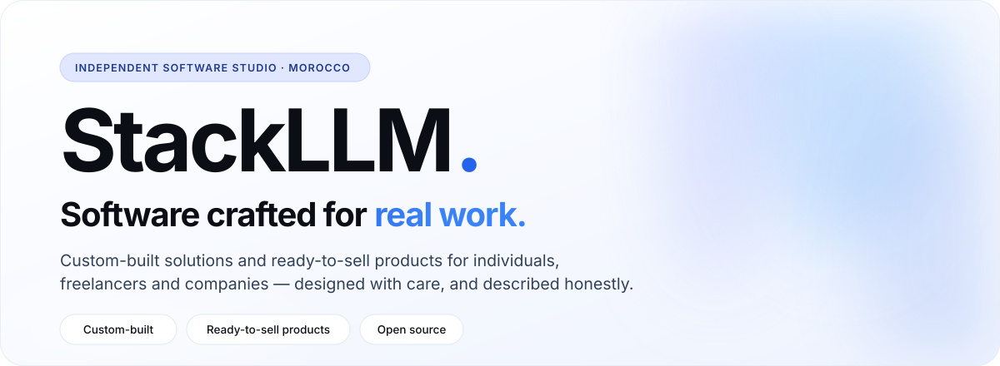

  

StackLLM is an independent software organisation based in Morocco. It brings together the products I design and build myself, separate from the work I delivered for the companies I worked for.

## Approach

<table>
  <tr>
    <td width="33%" valign="top">
      <h3>I · Custom-built</h3>
      Software designed around one client's process — for an individual, a freelancer or a company.
    </td>
    <td width="33%" valign="top">
      <h3>II · Ready-to-sell products</h3>
      Built once for a real need, then offered to everyone who shares it.
    </td>
    <td width="33%" valign="top">
      <h3>III · Open source</h3>
      When it makes sense, the code is opened so others can use it and build on it.
    </td>
  </tr>
</table>

## Products

<table>
  <tr>
    <th align="left" width="22%">Product</th>
    <th align="left">What it is</th>
    <th align="left" width="30%">Status</th>
  </tr>
  <tr>
    <td valign="top"><b>MySalary</b> Personal finance</td>
    <td valign="top">A personal finance assistant built around the salary: what is left today, this week and this month, and when each savings goal will be reached.</td>
    <td valign="top"></td>
  </tr>
  <tr>
    <td valign="top"><b>LucidNews</b> Tech watch · Newsletter</td>
    <td valign="top">A tech watch and IT newsletter that filters out the noise and labels how reliable each story is.</td>
    <td valign="top"></td>
  </tr>
  <tr>
    <td valign="top"><b>E-commerce Platform</b> Commerce · Automation</td>
    <td valign="top">A full-stack e-commerce platform with automation built in, not added on top.</td>
    <td valign="top"></td>
  </tr>
  <tr>
    <td valign="top"><b>Teaching Platform</b> Education · E-learning</td>
    <td valign="top">An e-learning platform for primary, middle and high school students.</td>
    <td valign="top"></td>
  </tr>
</table>

> **Honest by default.** No product is available in production yet, and there are no launch dates. Source repositories are private for now; public documentation and changelogs are published per product as they are ready.

## Work with us

To talk about a custom project or a collaboration:

- **Email** — [oussamakanouni39@gmail.com](mailto:oussamakanouni39@gmail.com)
- **LinkedIn** — [Oussama Al Mouallim El Kanouni](https://www.linkedin.com/in/oussama-al-mouallim-el-kanouni-0064a9224/)

## Founder

[Oussama Al Mouallim El Kanouni](https://github.com/oussamaalmouallim) — Cloud Solutions & AI Automation Engineer.

© 2026 StackLLM · Casablanca, Morocco

